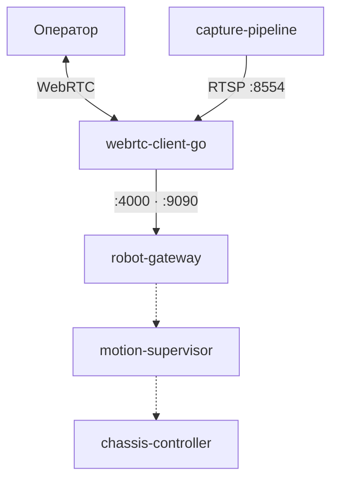

# teleop-robot

Телеуправляемый робот на шасси Remo Hobby и Raspberry Pi 5 (8 ГБ, Debian 13 ARM64).

Медиа и управление — разные контуры. Видео не ходит через ROS 2. Cyclone DDS остаётся на роботе. Контракты — в [docs/interfaces.md](docs/interfaces.md), не в общей библиотеке.

Сейчас Compose поднимает захват, шлюз и WebRTC-клиент. Супервизор и контроллер шасси — заглушки: пакетов и образов ещё нет.

## Как это работает

Оператор смотрит поток и шлёт команды с UI на сервере сигналинга. На борту три живых процесса и два будущих узла ROS 2.



Пунктир — ещё не в Compose. Сплошные стрелки — то, что поднимается сейчас.

1. `capture-pipeline` кодирует кадр (`x264enc`) и сам держит RTSP.
2. `webrtc-client-go` читает `rtsp://127.0.0.1:8554/live` и отдаёт его оператору. ROS 2 не линкует.
3. `robot-gateway` — `rosbridge_server` на `:9090` и тот же `robot-config` на `:4000` (пока клиент не вызывает `/robot/get_capabilities`).
4. `motion-supervisor` позже примет команду и опубликует её только после проверки. Пропуск команды без правил — не защита.
5. `chassis-controller` позже будет единственным, кто говорит с железом: тяга IBT-2 (RPWM/LPWM с PCA9685), руль SG90 на GPIO Pi, 50 Гц, не на той же PCA9685.

## Сервисы

| Сервис | Статус | Роль |
| --- | --- | --- |
| `services/capture-pipeline` | в Compose | Git subtree. Захват OV5647 (`libcamerasrc`) или `videotestsrc` на ноуте. RTSP `rtsp://127.0.0.1:8554/live`. Вне ROS 2. |
| `services/webrtc-client-go` | в Compose | Git submodule на Go. Сессия с оператором, чтение RTSP. Вне ROS 2. |
| `services/robot-gateway` | в Compose | `rosbridge_server`, `/robot/get_capabilities`, сокет `:4000` с тем же YAML. |
| `services/motion-supervisor` | заглушка | Узел ROS 2. Приём телеуправления, проверка, публикация дальше. Появится вместе с типом команды. |
| `services/chassis-controller` | заглушка | Узел ROS 2. Тяга IBT-2 на PCA9685; руль SG90 на GPIO, 50 Гц. По таймауту оба ШИМ тяги гасятся. |

Платформенные YAML — в [`config/`](config/). Состав робота в Compose — корневой [`compose.yaml`](compose.yaml) плюс оверлей из [`deploy/`](deploy/).

## Деплой

Git живёт только на ноуте. На робот уезжают **образы**, не дерево git и не rsync. YAML на плате не монтируют: в образ их кладёт `COPY` при `--build`. На ноуте оверлей `dev` монтирует `config/` поверх, чтобы править без пересборки.

Образы собирают там, где их запускают: ноут — `amd64`, Pi — `arm64`. В эксплуатации робот не пересобирает образы при каждом старте. Смена кода или платформенного YAML — снова `--build`.

| Файл | Зачем |
| --- | --- |
| `compose.yaml` | состав: `capture`, `gateway`, `webrtc` |
| `deploy/compose.dev.yaml` | ноут: `videotestsrc`, без privileged |
| `deploy/compose.robot.yaml` | Pi: OV5647, privileged ([ADR 0009](docs/decisions/0009-capture-pipeline-libcamera.md)), `restart: unless-stopped` |

### Ноут

Из корня репозитория:

```bash
git submodule update --init services/webrtc-client-go
docker compose -f compose.yaml -f deploy/compose.dev.yaml up --build
```

Проверка: `ffplay -rtsp_transport tcp rtsp://127.0.0.1:8554/live` (на emulate ещё `:8555`–`:8557`). UI: http://90.156.157.224:8080/view/raspbot

### Робот

С ноутбука. Демон Docker и камера — на Pi. Клона репозитория на плате нет.

```bash
# один раз
ssh-copy-id ebarykin@<pi-host>
docker context create raspbot --docker "host=ssh://ebarykin@<pi-host>"

docker --context raspbot compose \
  -f compose.yaml -f deploy/compose.robot.yaml up --build
```

Дальше, пока код и YAML в образах не менялись:

```bash
docker --context raspbot compose \
  -f compose.yaml -f deploy/compose.robot.yaml up --no-build -d
```

На роботе: OV5647, `/dev`, `/run/udev`. Если `libcamerasrc` не видит сенсор — `rpicam-hello --list-cameras` и при необходимости смонтировать `/usr/share/libcamera`.

### Что считается готовым к работе

- захват отдаёт H.264 на `rtsp://127.0.0.1:8554/live`;
- шлюз слушает `:9090` и сразу после handshake шлёт `robot-config` на `:4000`;
- клиент в комнате `raspbot` на 224, в логе webrtc есть `get-capabilities → reply robot-config`.

`motion-supervisor` и `chassis-controller` в этот состав не входят, пока нет пакетов и типа команды.

## Документы

- [docs/architecture.md](docs/architecture.md) — границы сервисов
- [docs/ros2.md](docs/ros2.md) — ROS 2 Jazzy и Cyclone DDS на роботе
- [docs/decisions/](docs/decisions/) — ADR

Правила агента — в `.cursor/rules/`. Архитектурное правило действует всегда.
