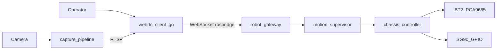

# Архитектура

Пять сервисов. ROS 2, шлюз и документация лежат в этом репозитории, `capture-pipeline` входит git subtree, `webrtc-client-go` — Git submodule. У `robot-gateway` и `capture-pipeline` уже есть Dockerfile. ROS 2 остаётся на роботе. Видео идёт отдельным контуром и в ROS 2 не входит.

## Кто за что отвечает

`webrtc-client-go` — Git submodule на Go. Он держит сессию с оператором. При подключении один раз вызывает `/robot/get_capabilities`, затем шлёт команды в `robot-gateway` протоколом rosbridge. Клиент не импортирует ROS 2.

`robot-gateway` — вход оператора: штатный `rosbridge_server` и узел `get_capabilities`. Свой мост не добавляется без пересмотра ADR 0003. Другие мосты, если появятся и не будут входом оператора, называются `{сторона}-ros-bridge`.

`motion-supervisor` получает команду и публикует её дальше после проверки. Пока супервизор только пропускает команду, он не защищает машину.

`chassis-controller` говорит с железом шасси. Тяга: IBT-2 (BTS7960), ШИМ с PCA9685, RPWM и LPWM; по таймауту оба входа гасятся. Руль на первом этапе: SG90 на GPIO Raspberry Pi, 50 Гц, не канал той PCA9685. Другие контроллеры называются `{подсистема}-controller`. Для физического робота нужна ещё независимая защита на уровне привода или MCU; программный таймаут её не заменяет.

`capture-pipeline` входит git subtree, захватывает OV5647 через `libcamerasrc`, кодирует кадр `x264enc` и публикует RTSP с `GstRTSPServer` на `rtsp://127.0.0.1:8554/live`. ROS 2 в этом сервисе нет. Образ и privileged для CSI — ADR 0009.

## Что ещё не собрано

Полный робот намеренно не запускается. Compose поднимает захват, шлюз и WebRTC-клиент. Пакеты шасси ещё не собраны.

Базовый `compose.yaml` — `capture`, `gateway`, `webrtc`. `deploy/compose.dev.yaml` — ноут, `deploy/compose.robot.yaml` — Pi. На роботе в эксплуатации используются образы с фиксированными версиями.

Граф ROS 2 ходит по Cyclone DDS (`rmw_cyclonedds_cpp`) и остаётся на роботе. Локальный discovery — `ROS_AUTOMATIC_DISCOVERY_RANGE=LOCALHOST`. Подробности — в [docs/ros2.md](ros2.md).
